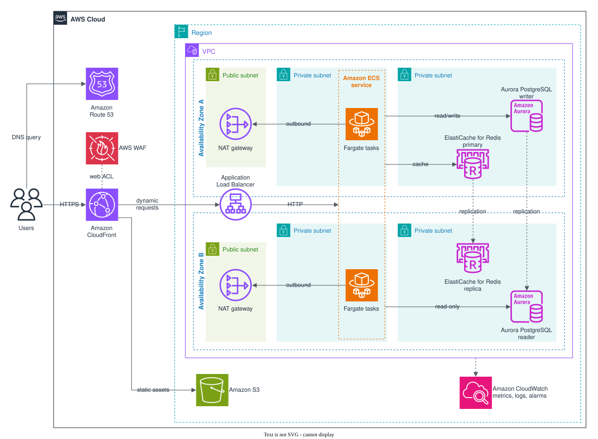
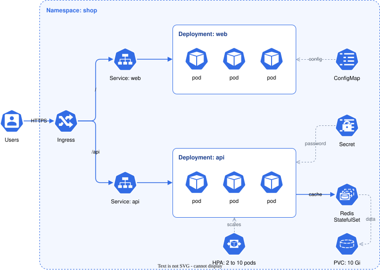
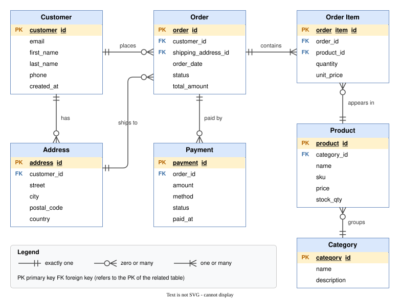
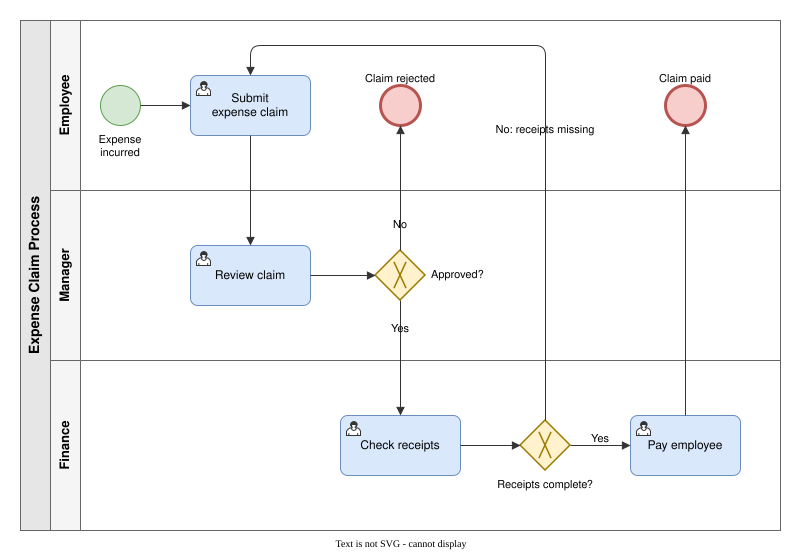
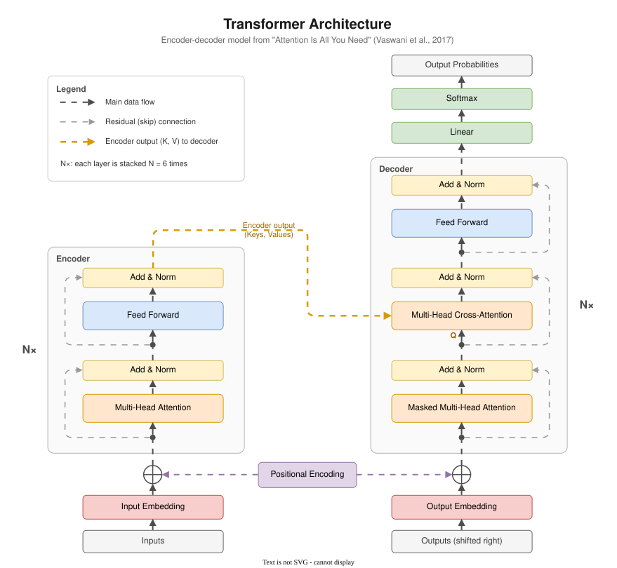
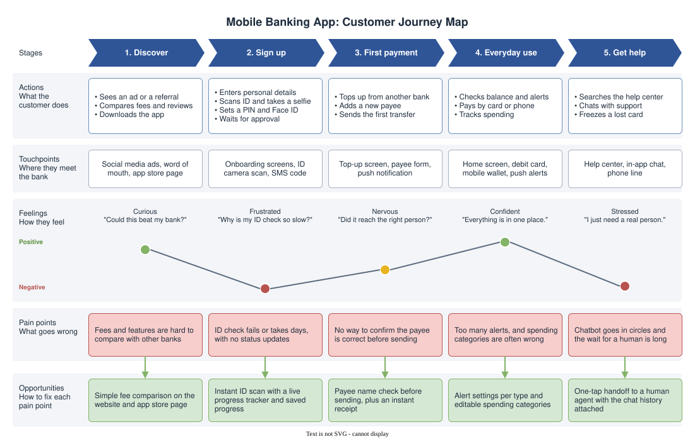

<div align="center">

# Next AI Draw.io

**Draw and edit draw.io diagrams by chatting with an AI.**

English | [中文](./docs/cn/README_CN.md) | [日本語](./docs/ja/README_JA.md)

[](https://next-ai-drawio.jiang.jp/)

[](https://opensource.org/licenses/Apache-2.0)
[](https://github.com/sponsors/DayuanJiang)

[**Live Demo**](https://next-ai-drawio.jiang.jp/) · [**Docs**](https://next-ai-drawio.jiang.jp/en/docs) · [**Gallery**](https://next-ai-drawio.jiang.jp/en/gallery) · [**Desktop App**](https://github.com/DayuanJiang/next-ai-draw-io/releases) · [**MCP Server**](https://next-ai-drawio.jiang.jp/en/mcp)

</div>

https://github.com/user-attachments/assets/66b9f12f-219f-4d62-acc0-0725e6850eec

Describe a diagram in a sentence and the AI draws it on a real draw.io canvas. Edit it by hand like any draw.io file, or select a few shapes and tell the AI what to change. Every AI change is a version you can compare, restore or undo, and the result exports as `.drawio`, `.png` or `.svg`.

Available as a web app, a desktop app for Windows, macOS and Linux, and an MCP server for AI agents such as Claude Code, Cursor and VS Code.

## Highlights

**Draw**

-   Architecture diagrams, flowcharts, sequence diagrams and more from one sentence, with built-in AWS, Azure, GCP and Kubernetes icon libraries
-   Connectors can carry a flowing animation
-   Upload a screenshot or a sketch and the AI redraws it; upload PDF, Markdown, code and other text files and get a diagram of their content

**Edit**

-   Edit by chat: changes stream onto the canvas and the shapes the AI just changed are highlighted
-   Ask about a selection: select shapes on the canvas and the AI changes only those
-   Versions and undo: every AI change is a version card with a thumbnail; compare it with the canvas, restore it or undo it, and Ctrl+Z on the canvas also takes back an AI change in one step
-   It is a normal draw.io diagram: double-click to rename, drag, restyle, use several pages, and export as `.drawio`, `.png`, `.svg` or `.drawio.svg` at any time

**Use**

-   25 model providers, including an OpenAI-compatible preset for any other URL; enter your own API key in the browser and it stays on your machine
-   Models that reason show their thinking
-   Dark mode; the interface is available in English, Simplified Chinese, Traditional Chinese and Japanese

## Examples

<div align="center">
<table width="100%">
  <tr>
    <td width="50%" valign="top">
      <strong>Highly available web app on AWS</strong><br />
      <p><strong>Prompt:</strong> Draw an AWS architecture for a highly available web app across two Availability Zones with AWS icons: Route 53, CloudFront with AWS WAF, an Application Load Balancer, ECS Fargate services in private subnets, Aurora PostgreSQL with a writer and a reader, ElastiCache for Redis, S3 for static assets, NAT gateways, and CloudWatch for monitoring.</p>
      <p><strong>Model:</strong> Claude Opus 5.5, in Claude Code with the MCP server</p>
      
    </td>
    <td width="50%" valign="top">
      <strong>Kubernetes deployment for a web shop</strong><br />
      <p><strong>Prompt:</strong> Draw a Kubernetes deployment for a web shop: an ingress, web and API deployments with their services and pods, a Redis StatefulSet with a persistent volume, a ConfigMap, a Secret, and an autoscaler on the API.</p>
      <p><strong>Model:</strong> Claude Opus 5.5, in Claude Code with the MCP server</p>
      
    </td>
  </tr>
  <tr>
    <td width="50%" valign="top">
      <strong>ER diagram of an online shop</strong><br />
      <p><strong>Prompt:</strong> Draw an ER diagram for an online shop: customers, addresses, orders, order items, products, categories and payments, with primary and foreign keys and the cardinality of each relationship.</p>
      <p><strong>Model:</strong> Claude Opus 5.5, in Claude Code with the MCP server</p>
      
    </td>
    <td width="50%" valign="top">
      <strong>BPMN expense claim process</strong><br />
      <p><strong>Prompt:</strong> Draw a BPMN process for an expense claim: an employee submits it, the manager approves or rejects it, finance checks the receipts and pays, and the claim goes back to the employee when receipts are missing.</p>
      <p><strong>Model:</strong> Claude Opus 5.5, in Claude Code with the MCP server</p>
      
    </td>
  </tr>
  <tr>
    <td width="50%" valign="top">
      <strong>Transformer architecture with animated connectors</strong><br />
      <p><strong>Prompt:</strong> Give me an animated connector diagram of transformer's architecture.</p>
      <p><strong>Model:</strong> Claude Opus 5.5, in Claude Code with the MCP server</p>
      
    </td>
    <td width="50%" valign="top">
      <strong>Customer journey map of a banking app</strong><br />
      <p><strong>Prompt:</strong> Draw a customer journey map for a mobile banking app across five stages (discover, sign up, first payment, everyday use, get help), with the customer's actions, touchpoints, feelings and pain points in each stage, and an opportunity for each pain point.</p>
      <p><strong>Model:</strong> Claude Opus 5.5, in Claude Code with the MCP server</p>
      
    </td>
  </tr>
</table>
</div>

More examples, each with its prompt and model, are in the **[gallery](https://next-ai-drawio.jiang.jp/en/gallery)**.

## Use it

### Online demo

Open [next-ai-drawio.jiang.jp](https://next-ai-drawio.jiang.jp/), nothing to install. The demo has a usage limit; click the settings icon in the chat panel and enter your own provider and API key to lift it. The key stays in your browser and is never sent to the server for storage.

### Desktop app

Download the Windows, macOS or Linux installer from the [Releases page](https://github.com/DayuanJiang/next-ai-draw-io/releases).

### In your AI agent (MCP)

https://github.com/user-attachments/assets/6f53a67b-ab21-4113-9fee-7fb32f9de678

Through MCP (Model Context Protocol, the protocol AI agents use to call outside tools), Claude Desktop, Cursor, VS Code and others can draw draw.io diagrams directly. Add this to your client's MCP configuration:

```json
{
  "mcpServers": {
    "drawio": {
      "command": "npx",
      "args": ["@next-ai-drawio/mcp-server@latest"]
    }
  }
}
```

In VS Code or Cursor, one click adds it: [](https://insiders.vscode.dev/redirect?url=vscode%3Amcp%2Finstall%3F%257B%2522name%2522%253A%2522drawio%2522%252C%2522command%2522%253A%2522npx%2522%252C%2522args%2522%253A%255B%2522%2540next-ai-drawio%252Fmcp-server%2540latest%2522%255D%257D) [](https://cursor.com/en/install-mcp?name=drawio&config=eyJjb21tYW5kIjoibnB4IiwiYXJncyI6WyJAbmV4dC1haS1kcmF3aW8vbWNwLXNlcnZlckBsYXRlc3QiXX0%3D)

For Claude Code, one command does it (`--scope user` makes it available in every project):

```bash
claude mcp add --scope user drawio -- npx @next-ai-drawio/mcp-server@latest
```

It is also a plugin in the Claude Code community marketplace (Claude Code 2.1.275 or later):

```text
/plugin install next-ai-drawio --marketplace anthropics/claude-plugins-community
```

Then ask the AI for "a flowchart of user authentication with login, MFA and session management" and the diagram appears in your browser as it is drawn. The MCP server has most of the web app's drawing features:

-   The same drawing rules, icon libraries (AWS, Azure, GCP, Kubernetes and more) and canvas as the web app: the AI's changes are outlined, one Ctrl+Z takes them back, and the AI reads the shapes you select
-   A screenshot tool, so the AI looks at the rendered diagram and fixes it
-   Version history, several pages, export as `.drawio`, `.png`, `.svg` or `.drawio.svg`, and auto-save to `~/.next-ai-drawio/`; the draw.io editor ships inside the package, so the preview works offline

The [MCP server page](https://next-ai-drawio.jiang.jp/en/mcp) has the setup for Codex, VS Code, Cursor and other clients, every tool, and how it compares with other draw.io MCP servers.

### Compared with draw.io's built-in AI

draw.io has its own Generate tool (Arrange > Insert > Generate). It runs inside draw.io on a free hosted model or your own API key, and it can change a diagram, page or selection that you attach to its chat. Next AI Draw.io sends the current canvas, including your hand edits, with every message, turns every AI change into a version you can compare or restore, and works with 25 providers, including local models through Ollama, on the demo site, in the desktop app or on your own server.

## Self-host

### Run locally

```bash
git clone https://github.com/DayuanJiang/next-ai-draw-io
cd next-ai-draw-io
npm install
cp env.example .env.local   # add your provider and API key, see "Models and providers" below
npm run dev
```

Open [http://localhost:6002](http://localhost:6002).

### One-click deploy

| Platform | How |
| --- | --- |
| Tencent EdgeOne Pages | [](https://edgeone.ai/pages/new?repository-url=https%3A%2F%2Fgithub.com%2FDayuanJiang%2Fnext-ai-draw-io) Deploying there also gives you a [daily free quota for DeepSeek models](https://pages.edgeone.ai/document/edge-ai) |
| Vercel | [](https://vercel.com/new/clone?repository-url=https%3A%2F%2Fgithub.com%2FDayuanJiang%2Fnext-ai-draw-io) Set the same environment variables in the Vercel dashboard as in your `.env.local` |
| Cloudflare Workers | [Cloudflare deploy guide](./docs/en/cloudflare-deploy.md) |
| Docker | [Docker guide](./docs/en/docker.md) |
| Offline or intranet | [Offline deployment](./docs/en/offline-deployment.md) |

### Models and providers

25 providers are supported: AWS Bedrock (default), OpenAI, Anthropic, Google AI, Google Vertex AI, Azure OpenAI, Ollama, OpenRouter, AIHubMix, DeepSeek, SiliconFlow, SGLang, Vercel AI Gateway, Tencent EdgeOne, ByteDance Doubao, ModelScope, Zhipu GLM, Qwen, Qiniu, Kimi, MiniMax, Novita, Xiaomi MiMo, Atlas Cloud, and an OpenAI-compatible preset for any other URL (vLLM, LM Studio, a gateway). The environment variables and notes for each are in the [provider configuration guide](./docs/en/ai-providers.md).

**Which model**: the task is to produce long text in a strict format (draw.io XML), so pick a capable model; small models tend to produce broken diagrams.

**Several models and the admin panel**: list several model IDs in `AI_MODEL` separated by commas, or configure models from several providers with the `AI_MODELS_CONFIG` environment variable or an `ai-models.json` file, and every user can use them without a key of their own. Set `ADMIN_PASSWORD` and open `/admin` to manage models, access codes, feature switches, observability and quotas from a web page; see the [admin panel guide](./docs/en/admin-panel.md).

## Support

-   Questions and ideas: open a [GitHub issue](https://github.com/DayuanJiang/next-ai-draw-io/issues) or email me[at]jiang.jp
-   Common problems: [FAQ](./docs/en/FAQ.md)
-   If the project is useful to you, consider [sponsoring](https://github.com/sponsors/DayuanJiang) to help keep the demo site running

<div align="center">

[](https://www.star-history.com/#DayuanJiang/next-ai-draw-io&type=date&legend=top-left)

</div>
