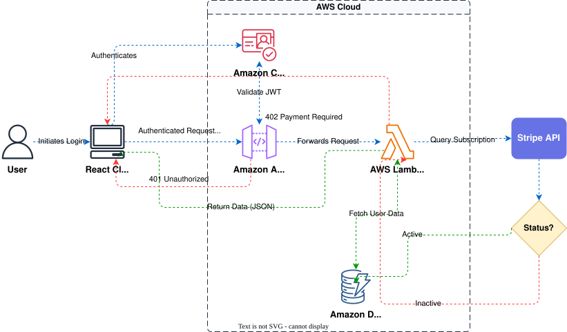

# テキストから AWS 構成図を作る

システムを文章で説明すると、Next AI Draw.io が draw.io の `aws4` 図形ライブラリにある公式の AWS アイコンを使って AWS 構成図を描きます。無料のオープンソースで、できあがるのは普通の draw.io の図です。手で編集したり、`.drawio`、`.png`、`.svg` として書き出したりできます。このページでは、よい初稿を得る方法と、それを仕上げる方法を説明します。

## 説明から始める

エディタで、システムの構成要素と、リクエストやデータがそれらの間をどう流れるかを説明します。たとえば次のように頼みます。

```text
AWS でサーバーレスの REST API を描いて。Lambda の前に API Gateway、サインインに Cognito、データに DynamoDB、アップロードされたファイルに S3。ユーザー以外はすべて AWS Cloud グループの中に入れて。
```

AI は描く前に AWS の図形ライブラリを調べるので、各サービスは汎用の四角形でなく、そのサービスの本物のアイコンで描かれます。

コツは次のとおりです。

- **サービス名を書く**：「データベース」だとどのデータベースにもなり得ますが、「DynamoDB」と書けば DynamoDB のアイコンになります。
- **グループを書く**：AWS Cloud、リージョン、VPC、アベイラビリティーゾーン、パブリックサブネットとプライベートサブネットなどです。
- **流れの向きを書く**：たとえば「左から右へ、ユーザーからデータベースへ」。
- **アニメーションするコネクタを頼む**：リクエストやデータの流れる向きが大事なときに使います。

<!-- demo: generate -->

## 手元の資料から始める

- **スクリーンショットやホワイトボードの写真**：アップロードして、AWS アイコンで描き直すよう AI に頼みます。
- **PDF や設計ドキュメント**：アップロードして、そこに書かれているアーキテクチャを図にするよう頼みます。
- **インフラのコード**：MCP サーバーを使うと、Claude Code や Cursor が Terraform、CDK、CloudFormation のファイルを読み、そこで定義されている構成を描きます。[Claude Code から使う](./claude-code.md)を参照してください。

```text
infra/ の Terraform ファイルを読んで、作成される AWS 構成を VPC とサブネットごとにまとめて図にして
```

## 仕上げる

- **図形を手で動かす**：好きな位置に置けます。AI は次に変更する前に、そのレイアウトを読み取ります。
- **サービスを選んで変更を頼む**：たとえば「この前にキャッシュを追加して」。
- **うまくいかなかった変更を取り消す**：AI の変更はすべてバージョンになります。カードから取り消すか、以前のバージョンを復元します。

## 例



プロンプト：「Generate authentication process using React with AWS. Use Serverless architecture.」

## エクスポート

- **.drawio**：このアプリでも draw.io でも、すべて編集できるまま残ります。
- **PNG**：スライドや文書向けの画像です。
- **SVG**：拡大してもぼやけない画像です。
