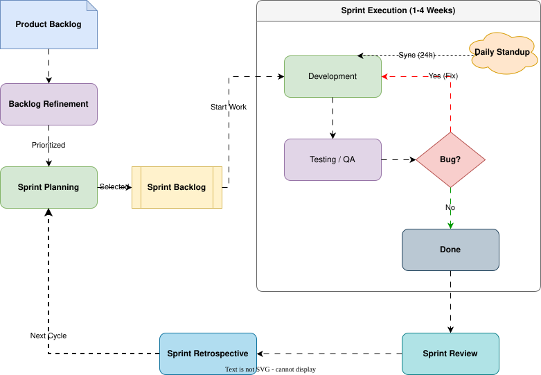

# 流程圖和時序圖

流程圖、泳道圖、BPMN 流程和時序圖產生出來都是普通的 draw.io 圖表，所以您可以繼續手動編輯。本頁介紹請求裡應該寫些什麼，才能得到清晰的初稿。

## 流程圖

依序描述各個步驟，並寫出每個判斷和它的結果：

```text
畫一張退款申請的流程圖：客戶提交表單，客服檢查訂單，如果訂單超過 30 天就拒絕申請，否則由財務退款，客戶會收到一封郵件。
```

有幫助的做法：

- **說明起點和終點。** 「從提交表單到發出郵件。」
- **寫出每個判斷和它的結果。** 「如果訂單超過 30 天：拒絕；否則：退款。」
- **說明誰做什麼**，就能得到泳道：「客戶、客服和財務各一條泳道」。
- **選定方向**：從上到下，或從左到右。

AI 會使用 draw.io 的流程圖和 BPMN 圖形庫：判斷用菱形表示；如果要求畫 BPMN，事件、閘道和任務都會使用 BPMN 圖形。

<!-- demo: flowchart -->

## 時序圖

先寫出參與者，再依序寫出它們之間的訊息，包括出錯的情況：

```text
畫一個使用簡訊驗證碼的登入時序圖，參與者有應用程式、認證 API、簡訊服務商和使用者。畫出驗證碼連續輸錯三次時會發生什麼。
```

請寫明重試、逾時和非同步回覆；否則圖裡可能只畫出一切順利時的路徑。

## 重畫現有的流程圖

附上白板照片、截圖或 PDF，讓 AI 重畫。結果是一張可以編輯的圖表，原來的圖片會換成真正的圖形和連線。之後照常提出修改，例如「合併兩個審核步驟」「在付款之後加一條出錯路徑」。

藉助 MCP 伺服器，AI 代理還可以根據您的程式碼畫圖，例如「把結帳 API 的請求流程畫成時序圖」。見[在 Claude Code 裡使用](./claude-code.md)。

## 讓圖表更易讀

- **「設定」裡的圖形風格**：「簡約」只用樸素的圖形，「精緻」會加上顏色和圖示。見[設定](./settings.md)。
- **動畫連線**可以顯示流程的方向；在請求裡提出即可。
- **選取圖表的一部分**，然後只針對這部分提出修改，例如「讓這些步驟間距均勻」。

## 範例



提示詞：「Generate agile scrum workflow diagram for software development team.」
